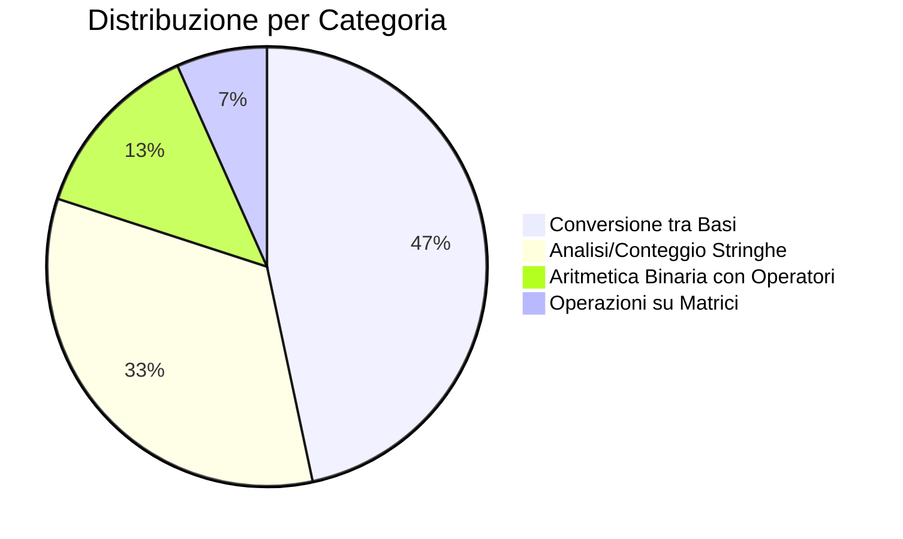

# 🎯 Analisi Completa Esercizi di Sbarramento — RISC-V Assembly

> [!IMPORTANT]
> Analisi basata sulla lettura diretta dei **15 README.pdf** originali delle tracce d'esame.
> Ogni esercizio è stato classificato per tipologia, con consigli mirati su cosa studiare.

---

## 📊 Vista d'insieme



---

## 🔵 CATEGORIA A — Conversione tra Basi Numeriche

**Frequenza: 7/15 (47%)** — La categoria più importante in assoluto.

> [!CAUTION]
> Quasi **metà degli esercizi** riguarda conversioni tra basi. Se non padroneggi questo argomento, non superi lo sbarramento.

### Esercizi di questa categoria

| # | Esercizio | Data Esame | Consegna Sintetica | Difficoltà |
|---|-----------|------------|-------------------|------------|
| A1 | [Sbarramento8](file:///Users/romolodeffereria/Desktop/Architettura/Sbarramento/Sbarramento8) | 09/05/2025 | Binario → **Ottale** (gruppi di 3 bit), separatore `/`, scartare bit extra | ⭐⭐ |
| A2 | [Sbarramento9](file:///Users/romolodeffereria/Desktop/Architettura/Sbarramento/Sbarramento9) | 09/05/2025 | Binario → **Base 4** (gruppi di 2 bit), separatore `/`, scartare bit extra | ⭐⭐ |
| A3 | [Sbarramento5](file:///Users/romolodeffereria/Desktop/Architettura/Sbarramento/Sbarramento5) | 24/01/2023 | Binario → **Ottale** (senza separatore), scartare bit residui, output su 3 righe + funzione `codificaOttale` | ⭐⭐⭐ |
| A4 | [Sbarramento7](file:///Users/romolodeffereria/Desktop/Architettura/Sbarramento/Sbarramento7) | 30/01/2023 | Binario → **Ottale** (senza separatore), padding bit mancanti con 0, output su 3 righe + funzione `codificaOttale` | ⭐⭐⭐ |
| A5 | [Sbarramento11](file:///Users/romolodeffereria/Desktop/Architettura/Sbarramento/Sbarramento11) | 11/09/2025 | **Esadecimale** → Decimale, separatore `/`, solo numeri terminati da `/` | ⭐⭐⭐ |
| A6 | [Sbarramento12](file:///Users/romolodeffereria/Desktop/Architettura/Sbarramento/Sbarramento12) | 29/10/2025 | **Esadecimale** → Binario e stampa con bit singoli (reverse dei bit hex) | ⭐⭐⭐ |
| A7 | [Sbarramento14](file:///Users/romolodeffereria/Desktop/Architettura/Sbarramento/Sbarramento14) | 18/02/2026 | **Esadecimale** → stampa hex + seleziona bit per posizione (maschera bit) | ⭐⭐⭐⭐ |

---

### Dettaglio di ogni esercizio

#### A1 — Sbarramento 8: Binario → Ottale con `/`
- **Input:** Stringa di `0`, `1`, `/` (es. `111/101000110/1111110`)
- **Output:** Per ogni gruppo separato da `/`, stampare la **conversione ottale** (gruppi di 3 bit). Bit residui in coda → **ignorati**
- **Esempio:** `111/101000110/1111110` → `7` / `506` / `77` (l'ultimo `0` è scartato)

#### A2 — Sbarramento 9: Binario → Base 4 con `/`
- **Input:** Come sopra, ma gruppi di **2 bit** → cifre in **base 4**
- **Output:** Per ogni gruppo separato da `/`, stampare la conversione in base 4. Bit residui → **ignorati**
- **Esempio:** `11/1010/111` → `3` / `22` / `3` (l'ultimo `1` di `111` è scartato)

#### A3 — Sbarramento 5: Binario → Ottale (con funzione)
- **Input:** Stringa binaria singola (es. `00110111101`)
- **Output su 3 righe:** stringa ottale, `0`/`1` se ci sono bit scartati, numero cifre ottali
- **Particolarità:** Richiede la scrittura di una **funzione `codificaOttale`** con argomenti `a0`, `a2` e ritorno `a3`, `a4`. La stampa deve avvenire nel `main`, NON nella funzione.
- **Bit residui:** **scartati** (non considerati)

#### A4 — Sbarramento 7: Binario → Ottale con Padding (con funzione)
- **Identico ad A3 ma con differenza fondamentale:** i bit mancanti vengono **paddati con 0** (non scartati)
- **Esempio:** `10110111101` → `5572` (gli ultimi `01` diventano `010` = 2)
- **Richiede funzione `codificaOttale`** + possibilità di bonus con versione **ricorsiva**

#### A5 — Sbarramento 11: Esadecimale → Decimale con `/`
- **Input:** Stringa di cifre hex (`0-9`, `A-F`) separate da `/`
- **Output:** Conversione in **decimale** di ogni numero hex terminato da `/`. Numeri non terminati da `/` → **ignorati**
- **Esempio:** `1AB0/BBB/` → `6832` e `3003`
- **Suggerimento traccia:** `16^x = 2^(4*x)` → usa `slli` per moltiplicare per 16

#### A6 — Sbarramento 12: Esadecimale con operazioni su bit
- **Input:** Stringa di cifre hex
- **Output:** Rappresentazione hex del numero e manipolazione bit
- **Particolarità:** Richiede comprensione di **maschera di bit** e selezione

#### A7 — Sbarramento 14: Esadecimale con maschera di bit
- **Input:** Stringa hex (es. `120A4`)
- **Output su 2 righe:** hex formattato `0x000120a4` + hex dei bit selezionati `0x00000004`
- **Logica:** Le singole cifre hex dell'input indicano **posizioni di bit** da selezionare nel numero stesso
- **Syscall speciale:** `a7=34` per stampa in esadecimale
- **Esercizio più difficile** della categoria

---

### 📖 Cosa studiare per la Categoria A

> [!TIP]
> **Concetti fondamentali da padroneggiare:**
>
> 1. **Conversione binario → ottale:** raggruppare 3 bit da sinistra, ogni gruppo = 1 cifra ottale (0-7)
> 2. **Conversione binario → base 4:** raggruppare 2 bit da sinistra, ogni gruppo = 1 cifra (0-3)
> 3. **Conversione hex → decimale:** ogni cifra hex × 16^posizione
> 4. **Gestione bit residui:** decidere se scartare o paddare con 0 (leggere BENE la traccia!)
> 5. **Parsing con separatore `/`:** confronto byte con `0x2F`
> 6. **Shift logici:** `slli` per moltiplicare per potenze di 2, `srli` per dividere

**Pattern di codice — Conversione binario → ottale (gruppi di 3):**
```asm
    li t2, 0            # accumulatore cifra ottale
    li t3, 0            # contatore bit nel gruppo (0,1,2)
loop:
    lb t1, 0(t0)        # carica bit corrente
    # ... check fine stringa o separatore ...
    addi t1, t1, -48    # ASCII → valore (0 o 1)
    slli t2, t2, 1      # shift accumulatore a sinistra
    or t2, t2, t1       # inserisci bit
    addi t3, t3, 1      # incrementa contatore
    li t4, 3
    bne t3, t4, skip    # se non 3 bit, continua
    # --- Gruppo completo ---
    addi t2, t2, 48     # valore → ASCII
    sb t2, 0(t5)        # salva cifra in output
    addi t5, t5, 1      # avanza output
    li t2, 0            # azzera accumulatore
    li t3, 0            # azzera contatore
skip:
    addi t0, t0, 1      # avanza input
    j loop
```

**Pattern — Conversione hex → decimale:**
```asm
    li t2, 0            # accumulatore numero
hex_loop:
    lb t1, 0(t0)
    # check se è '/' o '\n'
    # Se cifra '0'-'9': addi t1, t1, -48
    # Se lettera 'A'-'F': addi t1, t1, -55  (perché 'A'=65, 65-55=10)
    slli t2, t2, 4      # t2 *= 16
    add t2, t2, t1      # t2 += cifra
    addi t0, t0, 1
    j hex_loop
```

---

## 🟢 CATEGORIA B — Analisi e Conteggio su Stringhe di Cifre

**Frequenza: 5/15 (33%)**

### Esercizi di questa categoria

| # | Esercizio | Data Esame | Consegna Sintetica | Difficoltà |
|---|-----------|------------|-------------------|------------|
| B1 | [Sbarramento3](file:///Users/romolodeffereria/Desktop/Architettura/Sbarramento/Sbarramento3) | 10/06/2022 | Contare occorrenze di `0` e di `1` in stringa binaria + funzione `contaOccorrenze` | ⭐ |
| B2 | [Sbarramento4](file:///Users/romolodeffereria/Desktop/Architettura/Sbarramento/Sbarramento4) | 22/09/2022 | Contare coppie consecutive identiche + somma cifre + funzione `contaOccorrenze` | ⭐⭐ |
| B3 | [Sbarramento6](file:///Users/romolodeffereria/Desktop/Architettura/Sbarramento/Sbarramento6) | 03/11/2022 | Somma valori presi a **due a due** (cifre decimali) + numero totale cifre | ⭐⭐ |
| B4 | [Sbarramento1](file:///Users/romolodeffereria/Desktop/Architettura/Sbarramento/Sbarramento1) | 12/02/2025 | Contare occorrenze pari/dispari (cifre 3-8), ignorare primo carattere, gestire `?` | ⭐⭐⭐ |
| B5 | [Sbarramento13](file:///Users/romolodeffereria/Desktop/Architettura/Sbarramento/Sbarramento13) | 20/01/2026 | Prendere cifre a coppie come numero decimale, ignorare se contiene `9`, contare divisibili per 4 | ⭐⭐⭐ |

---

### Dettaglio di ogni esercizio

#### B1 — Sbarramento 3: Contare 0 e 1
- **Input:** Stringa binaria (es. `0110101011`)
- **Output:** Riga 1 = numero di `0`, Riga 2 = numero di `1`
- **Funzione richiesta:** `contaOccorrenze(a0) → v0 (conta 0), v1 (conta 1)`
- **Nota:** Traccia originale in **MIPS** (usa `$v0`, `$a0` ecc.), ma l'esercizio probabilmente va svolto in RISC-V adattando
- **Bonus:** soluzione ricorsiva

#### B2 — Sbarramento 4: Coppie identiche + Somma cifre
- **Input:** Stringa di cifre 0-9 (es. `1123455`)
- **Output:** Riga 1 = coppie consecutive identiche (`11` e `55` → 2), Riga 2 = somma cifre (1+1+2+3+4+5+5 = 21)
- **Funzione richiesta:** `contaOccorrenze(a0) → a1 (coppie), a2 (somma)`
- **Bonus:** soluzione ricorsiva

#### B3 — Sbarramento 6: Somma cifre a coppie + Conteggio
- **Input:** Stringa di cifre 0-9 (es. `11014`)
- **Output:** Riga 1 = somma dei numeri presi **a due a due** (`11 + 01 + 4 = 16`), Riga 2 = numero totale cifre
- **Attenzione:** se numero cifre è dispari, l'ultima cifra va come unità (non decina)
- **Funzione richiesta:** `contaOccorrenze(a0) → a1 (somma), a2 (num cifre)`
- **Bonus:** soluzione ricorsiva

#### B4 — Sbarramento 1: Occorrenze pari/dispari con filtro
- **Input:** Stringa di cifre 0-9 con possibile `?` iniziale (es. `?80085`)
- **Output:** Riga 1 = occorrenze **pari** (solo cifre >2 e <9, escluso primo char), Riga 2 = occorrenze **dispari**
- **Logica complessa:** ignorare primo carattere, filtrare solo cifre 3,4,5,6,7,8
- **Funzione richiesta:** `contaOccorrenze(a0) → a0 (pari), a1 (dispari)`

#### B5 — Sbarramento 13: Coppie di cifre, filtro 9, divisibilità per 4
- **Input:** Stringa di cifre 0-9 (es. `89404`)
- **Output:** Riga 1 = coppie divisibili per 4 (ignorando quelle con `9`), Riga 2 = coppie non divisibili per 4
- **Logica:** prendi 2 cifre → forma numero decimale → se contiene `9` ignora, altrimenti check `rem` per divisibilità
- **Se cifre dispari:** ultima cifra presa singolarmente

---

### 📖 Cosa studiare per la Categoria B

> [!TIP]
> **Concetti fondamentali:**
>
> 1. **Loop su stringa** carattere per carattere con `lb`
> 2. **Conversione ASCII → valore numerico:** `addi t1, t1, -48`
> 3. **Confronto tra carattere corrente e precedente** (per coppie identiche)
> 4. **Contatori multipli:** usare registri diversi per ogni contatore
> 5. **Raggruppamento a coppie:** flag pari/dispari con alternanza, o contatore modulo 2
> 6. **Test di parità:** `andi t2, t1, 1` → se 0 è pari, se 1 è dispari
> 7. **Divisibilità per 4:** `rem t2, t1, t3` con `t3=4`, oppure `andi t2, t1, 3`
> 8. **Filtrare cifre:** `blt` e `bge` per range (>2 e <9)
> 9. **Struttura a funzione:** `jal`, `jalr`, salvare `ra` sullo stack se necessario

**Pattern — Raggruppamento a coppie di cifre decimali:**
```asm
    li t3, 0            # contatore posizione (0=decine, 1=unità)
    li t4, 0            # accumulatore coppia
loop:
    lb t1, 0(t0)
    beq t1, x0, fine    # fine stringa
    addi t1, t1, -48    # ASCII → valore
    beqz t3, decine
    # È la cifra delle unità
    add t4, t4, t1      # completa il numero
    # ... elabora t4 (il numero a 2 cifre) ...
    li t3, 0            # resetta per prossima coppia
    j next
decine:
    li t5, 10
    mul t4, t1, t5      # cifra × 10
    li t3, 1            # prossima sarà unità
next:
    addi t0, t0, 1
    j loop
```

---

## 🟡 CATEGORIA C — Aritmetica Binaria con Operatori Inline

**Frequenza: 2/15 (13%)**

### Esercizi di questa categoria

| # | Esercizio | Data Esame | Consegna Sintetica | Difficoltà |
|---|-----------|------------|-------------------|------------|
| C1 | [Sbarramento10](file:///Users/romolodeffereria/Desktop/Architettura/Sbarramento/Sbarramento10) | 09/05/2025 | Numeri binari separati da `+`, sommare e stampare risultato decimale | ⭐⭐ |
| C2 | [Sbarramento15](file:///Users/romolodeffereria/Desktop/Architettura/Sbarramento/Sbarramento15) | 14/09/2026 | Numeri binari separati da `-`, **sottrarre** e stampare risultato decimale | ⭐⭐⭐ |

---

### Dettaglio

#### C1 — Sbarramento 10: Somma binaria con `+`
- **Input:** `11+0000+1+0010`
- **Output:** `6` (perché 3+0+1+2 = 6)
- **Logica:** Parsing con separatore `+` (ASCII `0x2B`), conversione bin→dec di ogni blocco, somma progressiva

#### C2 — Sbarramento 15: Sottrazione binaria con `-`
- **Input:** `11-0000-1-0010`
- **Output:** `0` (perché 3-0-1-2 = 0)
- **Attenzione:** Il primo numero è **sempre positivo** (non preceduto da `-`), tutti gli altri vanno sottratti
- **Risultato può essere negativo:** es. `1-1001-11-0011-000` → `-14`

---

### 📖 Cosa studiare per la Categoria C

> [!TIP]
> **Concetti fondamentali:**
>
> 1. **Conversione binario → decimale in un accumulatore:**
>    ```asm
>    slli t2, t2, 1   # accumulatore *= 2
>    add t2, t2, t1   # accumulatore += bit corrente (0 o 1)
>    ```
> 2. **Parsing con separatore:** confronto byte con `+` (`0x2B`) o `-` (`0x2D`)
> 3. **Gestione primo numero vs successivi:** flag o contatore per sapere se sommare o sottrarre
> 4. **Stampa intero con segno:** la syscall `a7=1` gestisce già i numeri negativi

**Pattern — Somma/sottrazione di numeri binari:**
```asm
    li s0, 0        # risultato totale
    li t2, 0        # accumulatore numero corrente
    li t6, 1        # flag: 1 = primo numero (addiziona), dopo = sottrai
loop:
    lb t1, 0(t0)
    # Se '\n' o '\0': aggiungi ultimo numero e stampa
    # Se '+' o '-': converti numero corrente, aggiungilo a s0, reset t2
    # Altrimenti: bit binario → accumula
    addi t1, t1, -48
    slli t2, t2, 1
    add t2, t2, t1
    addi t0, t0, 1
    j loop
```

---

## 🟣 CATEGORIA D — Operazioni su Matrici

**Frequenza: 1/15 (7%)**

### Esercizio

| # | Esercizio | Data Esame | Consegna Sintetica | Difficoltà |
|---|-----------|------------|-------------------|------------|
| D1 | [Sbarramento2](file:///Users/romolodeffereria/Desktop/Architettura/Sbarramento/Sbarramento2) | 14/02/2025 | Matrice N×N: stampare **somma dei primi 2 elementi di ogni riga** | ⭐⭐⭐ |

---

### Dettaglio

#### D1 — Sbarramento 2: Somma primi 2 elementi per riga
- **Input:** Prima N (dimensione), poi N×N interi
- **Output:** Somma dei primi due elementi di ogni riga
- **Casi base:** N=0 → `0`, N=1 → l'unico elemento
- **Esempio:** N=3, matrice `1 1 4 / 2 2 6 / 3 5 6` → `(1+1) + (2+2) + (3+5) = 14`
- **La matrice è già in memoria:** `a0` = indirizzo base matrice, `a1` = indirizzo di N
- **Input gestito automaticamente** dal template (non devi leggere tu i numeri)

---

### 📖 Cosa studiare per la Categoria D

> [!TIP]
> **Concetti fondamentali:**
>
> 1. **Leggere word dalla memoria:** `lw t1, 0(t0)` (ogni int = 4 byte)
> 2. **Indirizzamento array:** elemento `[i]` = base + i×4
> 3. **Accesso a matrice lineare:** elemento `[r][c]` = base + (r×N + c) × 4
> 4. **Primi 2 di ogni riga:** offset `r×N×4` e `(r×N+1)×4`
> 5. **Loop su righe:** da 0 a N-1

**Pattern — Somma primi 2 elementi per riga:**
```asm
    lw s1, 0(a1)        # N = dimensione matrice
    mv t0, a0            # base matrice
    li s0, 0             # accumulatore risultato
    li t3, 0             # contatore riga
riga_loop:
    bge t3, s1, fine     # se riga >= N, fine
    lw t1, 0(t0)         # primo elemento riga
    add s0, s0, t1
    li t4, 1
    bge t4, s1, skip_2   # se N=1, non c'è secondo
    lw t1, 4(t0)         # secondo elemento riga
    add s0, s0, t1
skip_2:
    slli t5, s1, 2       # N × 4 = byte per riga
    add t0, t0, t5       # avanza alla prossima riga
    addi t3, t3, 1
    j riga_loop
```

---

## 📋 Riepilogo Completo

| Categoria | Esercizi (per cartella) | % | Priorità |
|-----------|------------------------|---|----------|
| 🔵 **A — Conversione Basi** | Sb5, Sb7, Sb8, Sb9, Sb11, Sb12, Sb14 | **47%** | ⭐⭐⭐⭐⭐ |
| 🟢 **B — Analisi/Conteggio Stringhe** | Sb1, Sb3, Sb4, Sb6, Sb13 | **33%** | ⭐⭐⭐⭐ |
| 🟡 **C — Aritmetica Binaria** | Sb10, Sb15 | **13%** | ⭐⭐⭐ |
| 🟣 **D — Matrici** | Sb2 | **7%** | ⭐⭐ |

---

## 🧠 Riferimento Rapido — Syscall e Istruzioni

### Syscall (ecall)

| `a7` | Operazione | Argomenti |
|------|-----------|-----------|
| `1` | Stampa intero (decimale) | `a0` = valore |
| `4` | Stampa stringa | `a0` = indirizzo stringa |
| `5` | Leggi intero | → risultato in `a0` |
| `8` | Leggi stringa | `a0` = buffer, `a1` = max lunghezza |
| `10` | Exit | — |
| `11` | Stampa singolo carattere | `a0` = codice ASCII |
| `34` | Stampa intero in **esadecimale** | `a0` = valore |

### Codici ASCII da ricordare

| Carattere | Codice Hex | Codice Dec |
|-----------|-----------|------------|
| `'0'` | `0x30` | 48 |
| `'9'` | `0x39` | 57 |
| `'A'` | `0x41` | 65 |
| `'F'` | `0x46` | 70 |
| `'+'` | `0x2B` | 43 |
| `'-'` | `0x2D` | 45 |
| `'/'` | `0x2F` | 47 |
| `'?'` | `0x3F` | 63 |
| `'\n'` | `0x0A` | 10 |
| `'\0'` | `0x00` | 0 |

### Istruzioni chiave

| Istruzione | Uso tipico |
|------------|-----------|
| `lb rd, offset(rs)` | Carica 1 byte (per stringhe) |
| `lw rd, offset(rs)` | Carica 1 word (per interi/matrici) |
| `sb rs, offset(rd)` | Salva 1 byte |
| `sw rs, offset(rd)` | Salva 1 word |
| `slli rd, rs, n` | Shift sinistro = moltiplicare per 2^n |
| `srli rd, rs, n` | Shift destro = dividere per 2^n |
| `andi rd, rs, imm` | AND con immediato (maschere bit) |
| `rem rd, rs1, rs2` | Resto divisione (per divisibilità) |
| `mul rd, rs1, rs2` | Moltiplicazione |
| `jal ra, label` | Chiamata a funzione |
| `jalr x0, ra, 0` | Ritorno da funzione (equivale a `ret`) |

---

## 💡 Strategia d'Esame

> [!IMPORTANT]
> ### I 5 comandamenti per lo Sbarramento
>
> **1. Leggi la traccia 3 volte** — Ogni volta noti un dettaglio nuovo (padding vs scarto? primo char ignorato? separatore inclusivo?)
>
> **2. Studia i test case** — Gli `.in` e `.expt` sono la verità assoluta. Se la tua comprensione della traccia non produce gli output attesi, è la tua comprensione a essere sbagliata.
>
> **3. Scrivi prima lo pseudocodice** — 5 minuti di pensiero ti risparmiano 30 minuti di debugging
>
> **4. Inizia dal caso più semplice** — Fai passare `test-00` prima di tutto, poi gestisci gli edge case
>
> **5. Il bonus viene DOPO** — Non ottimizzare fino a quando tutti i test non passano

> [!WARNING]
> ### Trappole ricorrenti
> - **`\n` alla fine dell'input:** `lb` lo carica — devi gestirlo come terminatore!
> - **Funzione richiesta:** Se la traccia dice di creare `codificaOttale` o `contaOccorrenze`, **devi** usare `jal`/`ret`. Non fare tutto nel `main`.
> - **Non modificare il data segment:** Usa solo i buffer già dichiarati
> - **Conversione hex 'A'-'F':** Il gap tra `'9'` (0x39) e `'A'` (0x41) è 8 — servono due branch separati
> - **Loop infiniti:** RARS limita a 305900 istruzioni e può **cancellare il tuo file** in caso di crash!

---

## 📅 Piano di Studio Consigliato

| Giorno | Focus | Esercizi da fare | Concetti chiave |
|--------|-------|-----------------|-----------------|
| **1** | Basi: loop su stringa, conteggi | Sb3, Sb4 | `lb`, loop, contatori, `addi -48` |
| **2** | Raggruppamento cifre | Sb6, Sb1 | Coppie di cifre, filtri, flag pari/dispari |
| **3** | Conversione bin→ottale semplice | Sb8 | Gruppi di 3, shift, separatore `/` |
| **4** | Conversione bin→base4 + variante | Sb9, Sb5 | Gruppi di 2, funzioni con `jal` |
| **5** | Conversione con padding | Sb7 | Differenza padding vs scarto |
| **6** | Aritmetica + sottrazione | Sb10, Sb15 | Parsing `+`/`-`, accumulatore |
| **7** | Hex e matrici | Sb11, Sb2 | Hex→dec, `lw`, accesso matrice |
| **8** | Esercizi avanzati | Sb13, Sb14, Sb12 | `rem`, maschere bit, `a7=34` |
| **9** | Ripasso completo | I 3 più difficili | Simula condizioni d'esame (tempo limitato) |
